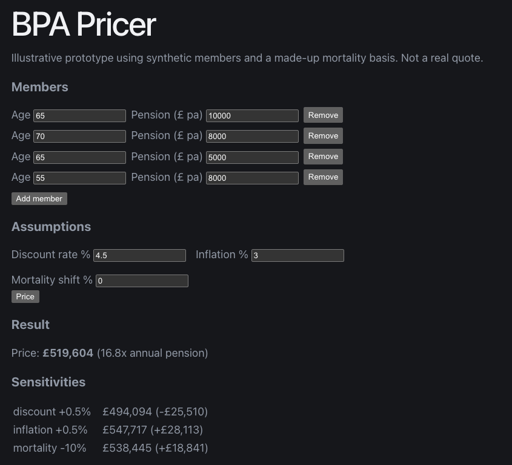
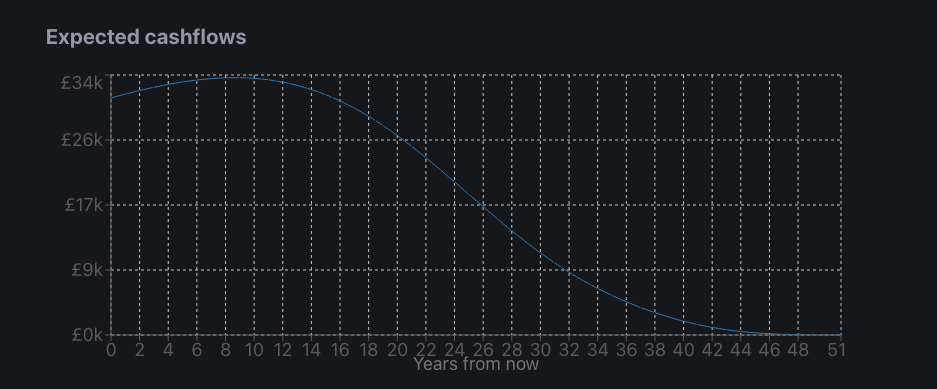

# BPA Pricer


An illustrative full-stack prototype that prices a bulk purchase annuity (BPA) for a small set of pension scheme members. Built to demonstrate pensions domain knowledge alongside Python, React and DevOps practice.

> **Prototype only.** It uses synthetic members and a made-up mortality basis. It is not a real quote or actuarial advice.



## What it does
- Takes member ages and annual pensions plus discount rate, inflation and a mortality adjustment
- Projects each member's expected pension payments year by year, weighted by survival probability
- Discounts the cashflows to a present value (the price) and shows it as a multiple of annual pension
- Reports three sensitivities (discount rate, inflation, mortality) and charts the expected cashflows

## Stack
- **Backend:** Python, FastAPI, pydantic (input validation), numpy
- **Frontend:** React, TypeScript, Vite, Recharts
- **Testing and CI:** pytest, GitHub Actions (tests run on every push)

## Run it locally
Backend:
```
cd backend
python -m venv .venv
source .venv/bin/activate
pip install fastapi uvicorn pytest numpy
uvicorn app:app --reload
```
Frontend (in a second terminal):
```
cd frontend
npm install
npm run dev
```
API docs are at `/docs` on the backend port (8000), and the app is on port 5173.

## Tests
```
cd backend
pytest
```
Two tests check the pricing function against hand calculations (zero mortality, one and two payments). Three more check that each assumption moves the price in the right direction.

## Assumptions and limitations
- Synthetic Gompertz-style mortality, with no sex split or real mortality table
- Flat discount rate rather than a gilt curve
- Annual payments with the first payment immediate, and a single inflation rate applied from year 0
- No revaluation, spouse pensions, lump sums or expenses

## Roadmap
- Deploy to Azure (App Service or Container Apps for the API, Static Web Apps for the frontend)
- Azure Blob Storage for member data uploads, with Key Vault and managed identity for secrets
- Entra ID authentication and role-based access
- Infrastructure as code (Bicep or Terraform), separate dev and prod environments
- CodeQL and Dependabot, plus monitoring with Application Insights
- A real mortality table and a yield curve
